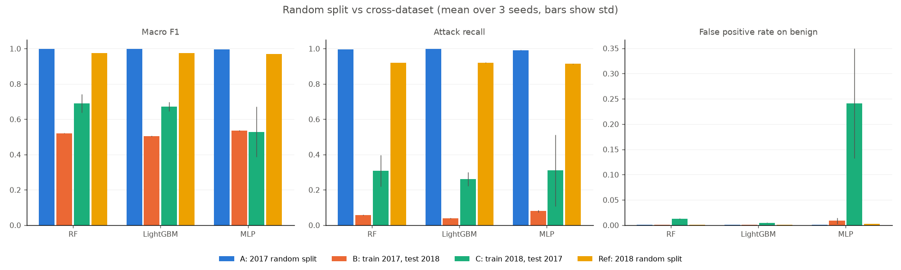
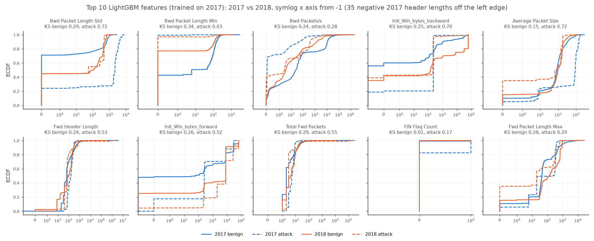

# ids-cross-dataset

Intrusion detectors often score around 99% on CIC-IDS2017 with a random
train/test split. I wanted to check how much of that survives when the same
model is tested on CSE-CIC-IDS2018, which the same lab (the Canadian Institute
for Cybersecurity) built a year later with the same flow tool, CICFlowMeter.

**Main finding:** models that reach 0.996 to 0.999 macro F1 on a random 2017
split catch only 4 to 8% of 2018 attacks (macro F1 0.50 to 0.54), so almost
none of the random-split score carries over.

## Data

- CIC-IDS2017, the 8 `MachineLearningCVE` CSVs (2.83 M flows).
- CSE-CIC-IDS2018, the 10 "Processed Traffic Data for ML Algorithms" CSVs
  (16.2 M flows, 6.9 GB). These are on AWS open data at
  `s3://cse-cic-ids2018` (no sign-in needed).

UNB's own download for 2017 redirects to a sign-up page, so I took the 2017
zip from a Hugging Face mirror (`bencorn/CICIDS2017`) and checked the extracted
file sizes against a second mirror. S3 was very slow from my connection, so I
took the 2018 files from the `c01dsnap/CIC-IDS2018` mirror. Its file sizes
match the S3 listing byte for byte, and each file matches the SHA-256 the
mirror publishes. Details are in NOTES.md.

Put the files here (the folder is gitignored):

```
data/raw/cic2017/   8 CSVs, e.g. Monday-WorkingHours.pcap_ISCX.csv
data/raw/cic2018/   10 CSVs, e.g. Wednesday-14-02-2018_TrafficForML_CICFlowMeter.csv
```

### Preparation

- Strip column names, drop the repeated header rows inside the 2018 files,
  turn inf into NaN, drop NaN rows, drop exact duplicates. Row counts per step
  are in `results/prep_counts.csv` and NOTES.md.
- The 2018 column names are mapped onto the 2017 names (`Tot Fwd Pkts` to
  `Total Fwd Packets` and so on). I keep the 76 flow features present in both,
  and later drop 8 that are constant in both, leaving 68.
- **I drop identifiers: Flow ID, IPs, source port, timestamp, protocol, and
  the destination port.** In 2017 the destination port nearly gives away the
  attack: every FTP-Patator flow goes to 21 and every SSH-Patator flow to 22,
  every DoS, DDoS and web attack flow to 80, 64% of Bot flows to 8080, and
  Heartbleed and Infiltration to 444. A model could score well by learning
  ports, not traffic behaviour.
- Dedup is done on the final feature columns plus label. Without the port,
  many flows become identical: 2017 PortScan goes from 158,930 to 1,956 rows,
  2018 FTP-BruteForce from 193,360 to 53, and 2018 DoS SlowHTTPTest from
  139,890 to 55.
- Labels: a binary benign/attack column plus a coarse family. Six families
  exist in both datasets: DoS, DDoS, brute force, web attack, bot,
  infiltration. Port scan and Heartbleed exist only in 2017.
- 2018 sample: 1.2 M rows, stratified by label with seed 42. Labels with fewer
  than 20k cleaned rows are kept whole and every other label is sampled at
  11%. I sized this for my laptop (19.8 GB RAM, about 5 GB of it actually
  free).

## Experiments

- **A**: random 80/20 split within 2017 (stratified by label).
- **B**: the same models as in A (trained on the 2017 80%), tested on the 2018
  sample.
- **C**: train on the 2018 sample, test on all of 2017.
- **Ref** (extra): random 80/20 split within the 2018 sample, so C has an
  in-domain number to compare against.

Models: Random Forest (100 trees), LightGBM (300 rounds), and a small sklearn
MLP (64-32, log-scaled and standardised inputs). Hyperparameters were set once
and are the same for every experiment, with a 0.5 decision threshold
throughout. Each experiment runs with 3 seeds (0, 1, 2).

## How to run

```bash
python -m venv .venv
.venv/Scripts/pip install -r requirements.txt   # .venv/bin/pip on Linux/macOS
python 01_prepare.py        # about 10 min, writes data/processed/
python 02_train_eval.py     # about 2 h on a 6-core laptop
python 03_feature_shift.py
python 04_make_figures.py
jupyter execute --inplace results.ipynb
```

`python 02_train_eval.py --quick` runs a small smoke test on 100k rows per
dataset and writes to `data/interim/quick_results/` instead of `results/`.

## Results

Mean ± std over 3 seeds (`results/main_table.csv`). FPR is the false positive
rate on benign traffic.

| Experiment | Model | Macro F1 | Attack recall | Benign FPR | AUROC |
|---|---|---|---|---|---|
| A: 2017 random split | RF | 0.998 ± 0.000 | 0.995 ± 0.000 | 0.04% | 1.000 |
| | LightGBM | 0.999 ± 0.000 | 0.998 ± 0.000 | 0.05% | 1.000 |
| | MLP | 0.996 ± 0.000 | 0.992 ± 0.001 | 0.10% | 1.000 |
| B: train 2017, test 2018 | RF | 0.520 ± 0.002 | 0.057 ± 0.002 | 0.08% | 0.828 ± 0.013 |
| | LightGBM | 0.504 ± 0.003 | 0.039 ± 0.003 | 0.05% | 0.767 ± 0.014 |
| | MLP | 0.536 ± 0.003 | 0.080 ± 0.006 | 0.86% ± 0.63 | 0.518 ± 0.006 |
| C: train 2018, test 2017 | RF | 0.690 ± 0.053 | 0.309 ± 0.089 | 1.23% ± 0.10 | 0.825 ± 0.003 |
| | LightGBM | 0.670 ± 0.026 | 0.261 ± 0.039 | 0.46% ± 0.06 | 0.854 ± 0.087 |
| | MLP | 0.529 ± 0.143 | 0.310 ± 0.203 | 24.1% ± 10.8 | 0.543 ± 0.129 |
| Ref: 2018 random split | RF | 0.974 ± 0.000 | 0.919 ± 0.000 | 0.10% | 0.985 |
| | LightGBM | 0.976 ± 0.000 | 0.921 ± 0.000 | 0.05% | 0.990 |
| | MLP | 0.969 ± 0.000 | 0.914 ± 0.001 | 0.27% | 0.983 ± 0.001 |

Per-family recall, mean over seeds (`results/per_family_recall.csv`):

| Experiment | Model | DoS | DDoS | Brute force | Web attack | Bot | Infiltration |
|---|---|---|---|---|---|---|---|
| A | RF | 0.996 | 1.000 | 0.990 | 0.954 | 0.624 | 0.667 |
| A | LightGBM | 0.999 | 1.000 | 0.998 | 0.986 | 0.656 | 0.667 |
| A | MLP | 0.992 | 0.999 | 0.969 | 0.918 | 0.598 | 0.095 |
| B | RF | 0.282 | 0.004 | 0.000 | 0.001 | 0.000 | 0.000 |
| B | LightGBM | 0.191 | 0.004 | 0.000 | 0.003 | 0.000 | 0.000 |
| B | MLP | 0.371 | 0.013 | 0.002 | 0.000 | 0.000 | 0.010 |
| C | RF | 0.524 | 0.006 | 0.138 | 0.009 | 0.000 | 0.000 |
| C | LightGBM | 0.332 | 0.182 | 0.002 | 0.018 | 0.000 | 0.018 |
| C | MLP | 0.476 | 0.088 | 0.005 | 0.081 | 0.002 | 0.167 |



What I take from it:

- The 2017 models don't flag 2018 traffic wildly. Their false positive rate
  stays under 1%, but they wave almost every 2018 attack through as benign.
  RF and LightGBM still rank attacks above benign somewhat (AUROC 0.77 to
  0.83), so part of the loss is the decision threshold. I didn't re-pick the
  threshold, because the only data to pick it on would be the test set.
- Training on 2018 and testing on 2017 (C) is a bit better for the tree models
  but still far below the 0.97 those models reach inside 2018.
- Bot, brute force and web attack transfer at about zero in both directions.
  DoS is the only family that partly carries over.

### Which features shift

For the 10 features with the highest LightGBM gain I compared 2017 and 2018
with a two-sample KS test (`results/feature_shift.csv`). Nine of the ten shift
by a KS of 0.15 to 0.34 on benign traffic alone. The clearest examples are the
TCP initial window size (benign median 60 bytes in 2017 vs 8192 in 2018) and
the backward packet lengths. Three features shift by about 0.7 on attack
traffic. The decision rules learned on 2017 depend on exactly the features
that moved.



## Limitations

- **Labels.** Both datasets have documented labelling and flow-construction
  problems. Engelen et al. (2021) reconstructed or relabelled more than 20%
  of CIC-IDS2017's traffic traces, and Liu et al. (2022) report
  similar errors in CSE-CIC-IDS2018. I used the original labels on purpose,
  since those are what most papers use, so part of the drop may come from
  label noise and not from real traffic change. Two symptoms show up here:
  2017 Bot is only caught about 60% of the time even in-domain, and 2018
  Infiltration about 4% of the time even inside 2018.
- **Families that barely exist.** 2017 has 36 Infiltration rows (7 per test
  split) and 2018 brute force is almost all SSH, since FTP-BruteForce
  collapses to 53 rows after dedup. Per-family numbers for these are noisy.
- **One 2018 sample.** Keeping rare labels whole changes the attack mix, so
  the overall attack recall in B depends on the sample. For example, Slowloris
  is a third of the sampled DoS rows instead of about 5%. Per-family recall is
  less sensitive to this.
- **Strict dedup.** Deduping after dropping the port removes more rows than
  most papers do, so my A numbers aren't directly comparable to theirs.
- **No tuning.** Hyperparameters and the 0.5 threshold are fixed. In the first
  full run LightGBM diverged during training, so I added a cap on its leaf
  outputs and re-ran everything. I chose the cap from training data only and
  kept the first run in `results/first_run_lgbm_diverged_runs.csv`; NOTES.md
  has the details.
- **C tests on all of 2017,** including Port scan and Heartbleed, which have
  no counterpart in the 2018 training data. They are about 0.6% of 2017
  attacks after dedup.

## References

- I. Sharafaldin, A. H. Lashkari, A. A. Ghorbani. Toward Generating a New
  Intrusion Detection Dataset and Intrusion Traffic Characterization. ICISSP
  2018. doi:10.5220/0006639801080116
- G. Engelen, V. Rimmer, W. Joosen. Troubleshooting an Intrusion Detection
  Dataset: the CICIDS2017 Case Study. IEEE Security and Privacy Workshops
  (SPW) 2021. doi:10.1109/SPW53761.2021.00009
- L. Liu, G. Engelen, T. Lynar, D. Essam, W. Joosen. Error Prevalence in NIDS
  datasets: A Case Study on CIC-IDS-2017 and CSE-CIC-IDS-2018. IEEE CNS 2022.
  doi:10.1109/CNS56114.2022.9947235
- H. Liu, P. Patras. NetSentry: A Deep Learning Approach to Detecting
  Incipient Large-scale Network Attacks. arXiv:2202.09873, 2022. (They also
  train on one dataset and test on another, and note the broken FTP-BruteForce
  and SlowHTTPTest captures in 2018.)
- CSE-CIC-IDS2018 on AWS: https://registry.opendata.aws/cse-cic-ids2018/
